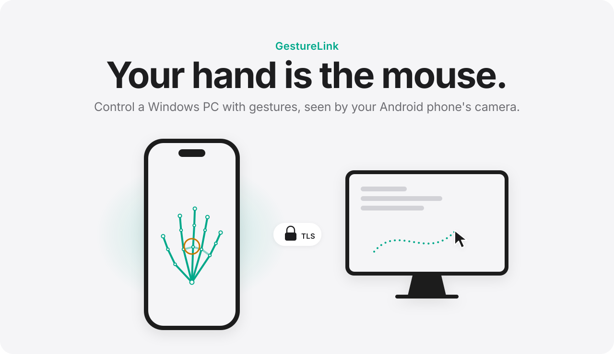
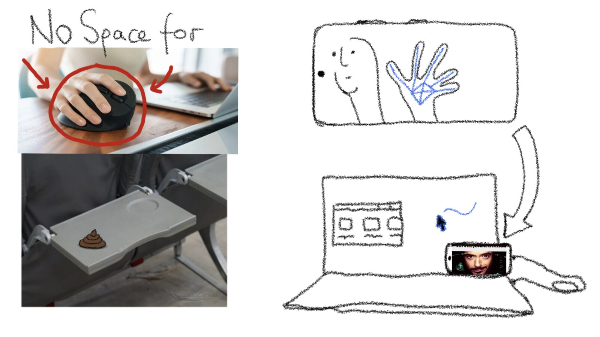
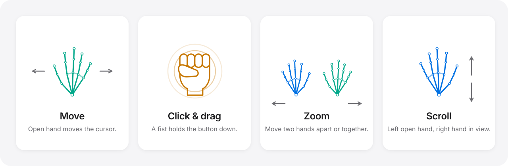
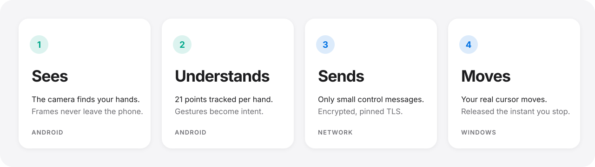
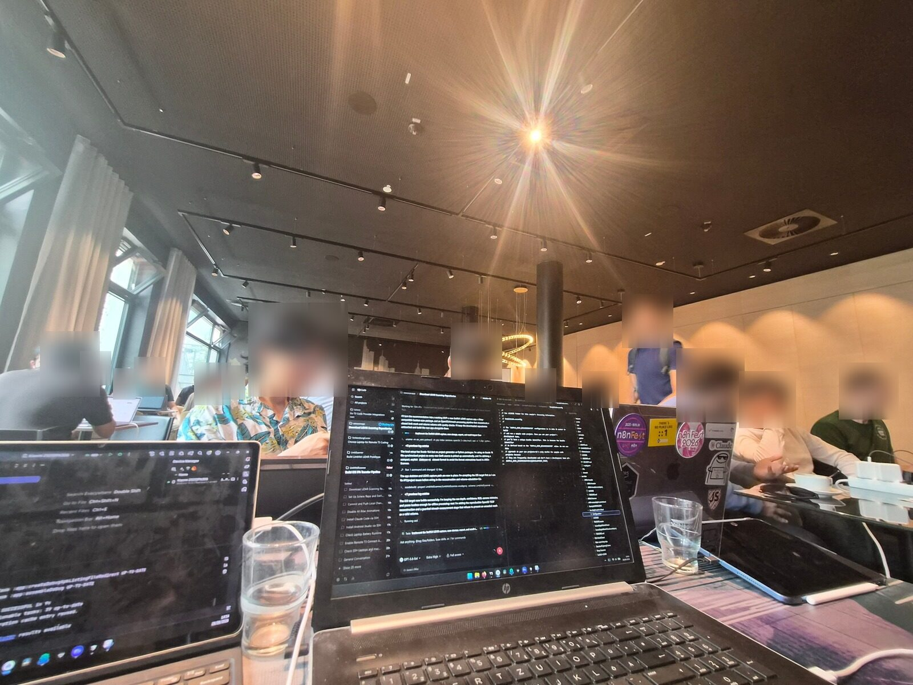

<div align="center">

<picture>
  <source media="(prefers-color-scheme: dark)" srcset="docs/assets/banner-dark.svg">
  
</picture>

<br><br>

**Move. Grab. Zoom. Your PC follows.**<br>
<sub>Private by design. Everything runs on your devices. Nothing goes to the cloud.</sub>

<br>

[The idea](#the-idea) &nbsp;·&nbsp; [Get started](#get-started) &nbsp;·&nbsp; [Gestures](#gestures) &nbsp;·&nbsp; [How it works](#how-it-works) &nbsp;·&nbsp; [Privacy](#privacy) &nbsp;·&nbsp; [Docs](docs/)

<br>

[](https://github.com/jonassneu/GestureLink/actions/workflows/android.yml)
[](https://github.com/jonassneu/GestureLink/actions/workflows/windows.yml)
[](LICENSE)

</div>

<br>

## The idea

Sometimes there's no room for a mouse: a cramped desk, a plane tray table, a laptop on your knees. But your phone is already in your pocket, and it has a camera. Stand it next to your laptop, raise your hand, and the cursor follows.

<p align="center">
  
</p>

<br>

## Gestures

Move your hand and the cursor follows. Close it to hold a button.

<picture>
  <source media="(prefers-color-scheme: dark)" srcset="docs/assets/gestures-dark.svg">
  
</picture>

<br>

| Gesture | What happens |
| :-- | :-- |
| Move one open hand | The cursor moves |
| Fingers close together | Slow, precise cursor |
| Fingers spread wide | Fast cursor |
| Hold a **right** fist | Right mouse button, held until you open your hand |
| Hold a **left** fist | Left mouse button, held until you open your hand. Move it to drag or draw. |
| Two hands apart / together | Zoom in / out |
| Left open hand, right hand in view | Scroll |

Opening your hand, leaving the camera's view, stopping control or disconnecting always releases the button.

<br>

## How it works

<picture>
  <source media="(prefers-color-scheme: dark)" srcset="docs/assets/how-it-works-dark.svg">
  
</picture>

<br>

The phone does all of the vision work with CameraX and MediaPipe. Windows only receives small, versioned control messages for cursor, click, scroll, zoom and status. These travel over TLS, pinned to the certificate you scanned. More in [Architecture](docs/architecture.md) and [Protocol v1](protocol/protocol-v1.md).

<br>

## Get started

You'll need Windows 10 or 11 with the **.NET 10 SDK**, the **Android SDK 37** with JDK 17 or newer (Android Studio includes both), and a phone running **Android 7 or later** with USB debugging on and `adb` in your `PATH`.

Connect your phone, then run:

```powershell
.\scripts\setup-demo.ps1
```

This command builds and tests both apps, installs the APK, opens a USB tunnel on port `39827`, starts the Windows agent and launches GestureLink on your phone. For later starts, add `-SkipBuild`.

1. **Pair.** Scan the QR code on your PC. That's it. Known phones reconnect automatically.
2. **Start.** Keep GestureLink open on your phone and tap **START**.
3. **Stop.** Leave the app or tap stop. Any input that's held is released instantly.

<details>
<summary><b>Use your local network instead of USB</b></summary>
<br>

The USB tunnel is a fallback for networks that isolate devices, such as guest Wi‑Fi. On a private network, put both devices on the same LAN and start the agent directly:

```powershell
dotnet run --project .\windows\GestureLink.Windows.App
```

Windows listens on TCP `39827` with TLS 1.2 or newer. Android pins the exact certificate fingerprint from the QR code.

</details>

<details>
<summary><b>Build each app on its own</b></summary>
<br>

**Android**

```powershell
cd android
.\gradlew.bat testDebugUnitTest lintDebug assembleDebug
adb install -r .\app\build\outputs\apk\debug\app-debug.apk
```

**Windows**

```powershell
.\scripts\build-windows.ps1
.\scripts\publish-windows.ps1
```

The portable build is written to `artifacts/windows-win-x64`. Smart App Control blocks freshly built unsigned executables. `setup-demo.ps1` works around this with the permitted .NET test host and leaves Windows security on. Releases you distribute should be code-signed.

</details>

<br>

## Privacy

Your camera feed stays on your phone. Here's what GestureLink does to keep it that way:

- **No cloud.** No account, no external server.
- **No recording.** Camera frames are never saved or uploaded. The microphone is never used.
- **Secure pairing.** Credentials are kept in Android Keystore. Windows stores only a hashed verifier.
- **Strict messages.** Length-bounded, versioned JSON over certificate-pinned TLS.
- **Fail-safe input.** Held input is released when you stop, disconnect, background the app, exit, or the connection times out.
- **Knows its limits.** It never tries to control UAC, the login screen or apps running with higher privileges.

More in [Security](docs/security.md).

<br>

## Status

Tested on a Xiaomi `25010PN30G` running Android 16:

| | |
| :-- | :-- |
| ✓ | Secure QR pairing and automatic reconnect |
| ✓ | USB connection over TLS |
| ✓ | Portrait and landscape |
| ✓ | Real Windows cursor movement |
| ✓ | 12 Android and 13 Windows tests passing |

Still to test on more hardware: click and zoom tuning, multiple monitors and display scaling, long sessions under heat, Android 7–17, and both Windows 10 and 11.

<br>

## Inside the repo

| | |
| :-- | :-- |
| [`android/`](android/) | Kotlin, Jetpack Compose, CameraX, MediaPipe |
| [`windows/`](windows/) | .NET 10 WPF agent, protocol server, Win32 input |
| [`protocol/`](protocol/) | Protocol v1, JSON schema, shared test fixtures |
| [`docs/`](docs/) | Architecture, calibration, security, testing, troubleshooting |
| [`scripts/`](scripts/) | Build, publish, verify, demo setup |

Product naming lives in one place on each platform: Android `AppConfig`/`BuildConfig` and Windows `ProductInfo`. The README artwork comes from [`docs/assets/generate.py`](docs/assets/generate.py).

<br>

## Built in 3 hours

GestureLink went from sketch to working demo in a single 3‑hour Cursor hackathon, and it won. 🏆

<p align="center">
  
</p>

<br>

<div align="center">
<sub>MIT License &nbsp;·&nbsp; Made by <a href="https://github.com/jonassneu">@jonassneu</a></sub>
</div>
