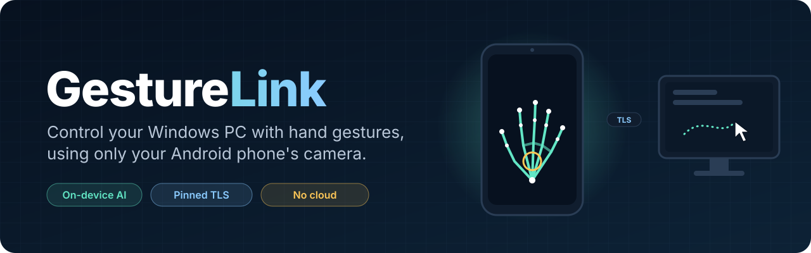
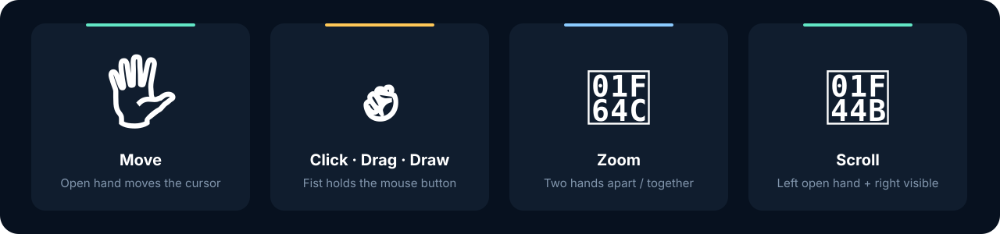
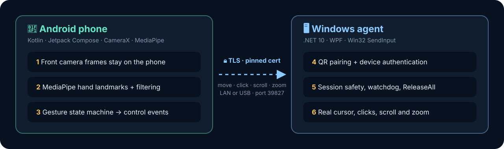

<div align="center">



<br>

[](https://github.com/jonassneu/GestureLink/actions/workflows/android.yml)
[](https://github.com/jonassneu/GestureLink/actions/workflows/windows.yml)
[](LICENSE)
<br>


**Wave at your PC. It listens.**<br>
GestureLink turns your Android phone's front camera into a touchless mouse for Windows.

[Quick start](#-quick-start) · [Gestures](#-gestures) · [How it works](#-how-it-works) · [Privacy](#-privacy--safety) · [Docs](docs/)

</div>

---

## ✨ Highlights

|  |  |
|---|---|
| 🧠 **On-device hand tracking** | MediaPipe runs on the phone. Camera frames never leave it. |
| 🔒 **Secure by default** | QR pairing, certificate-pinned TLS 1.2+, Android Keystore credentials |
| 🖱️ **Full mouse control** | Move, left/right click, drag, draw, scroll and zoom |
| 🛑 **Fail-safe** | Every held button is released on stop, disconnect, timeout or when the app goes to the background |
| 📡 **Offline** | Works over your local network or USB. No account, no cloud, no microphone. |

## 👋 Gestures



| Gesture | Result |
|---|---|
| Move one visible hand | Move cursor |
| Fingers close together | Low cursor sensitivity (precise) |
| Fingers spread wide | Very high cursor sensitivity (fast) |
| Hold **right** fist | Hold right mouse button until the hand opens |
| Hold **left** fist | Hold left mouse button until the hand opens. Move it to drag or draw. |
| Move two hands apart / together | Zoom in / out |
| Left open hand while the right is also visible | Scroll |

> [!TIP]
> A fist holds its mouse button down. Opening the hand, losing tracking, stopping control or disconnecting releases it.

## 🧩 How it works



The phone handles all the vision work. Windows only receives small, versioned JSON control messages (cursor, click, scroll, zoom, status) over a pinned TLS connection. See [`docs/architecture.md`](docs/architecture.md) and [`protocol/protocol-v1.md`](protocol/protocol-v1.md) for details.

## 🚀 Quick start

<details open>
<summary><b>Requirements</b></summary>

- Windows 10/11 with the **.NET 10 SDK**
- **Android Studio** or Android SDK 37 with JDK 17+
- Android 7+ phone with **USB debugging** enabled
- `adb` available in `PATH`

</details>

Connect one authorized Android phone, then run from the repository root:

```powershell
.\scripts\setup-demo.ps1            # build, test, install and launch
.\scripts\setup-demo.ps1 -SkipBuild # later starts, no rebuild
```

The script builds and tests both apps, installs the APK, creates an `adb reverse` tunnel on port `39827`, starts the Windows agent and opens GestureLink on the phone.

1. **Pair:** scan the QR code shown on Windows. Scanning it confirms pairing, so there is no second approval dialog. Known phones reconnect automatically.
2. **Start:** keep GestureLink visible on the phone and press **START**.
3. **Stop:** leave the app, stop control or disconnect. Simulated input is released immediately.

### 📶 Normal LAN mode

The USB tunnel is only a development fallback for guest Wi-Fi with client isolation. For normal use, put both devices on the same private LAN and start the agent without `-UsbTunnel`:

```powershell
dotnet run --project .\windows\GestureLink.Windows.App
```

Windows listens on TCP `39827` with TLS 1.2 or newer. Android pins the exact certificate fingerprint from the QR code.

<details>
<summary><b>🔨 Build each app separately</b></summary>

**Android**

```powershell
cd android
.\gradlew.bat testDebugUnitTest lintDebug assembleDebug
adb install -r .\app\build\outputs\apk\debug\app-debug.apk
```

**Windows**

```powershell
.\scripts\build-windows.ps1
.\scripts\publish-windows.ps1
```

The portable Windows build is written to `artifacts/windows-win-x64`.

> [!NOTE]
> On machines with Smart App Control enabled, a freshly built unsigned executable is blocked. `setup-demo.ps1` uses the permitted .NET test host instead, without disabling Windows security. A distributed release should be code-signed.

</details>

## 🔐 Privacy & safety

- ✅ No cloud account or external server
- ✅ No microphone permission
- ✅ No camera recording or camera upload
- ✅ Credentials protected by Android Keystore and a hashed Windows verifier
- ✅ Length-bounded, versioned JSON over certificate-pinned TLS
- ✅ `ReleaseAll` on stop, disconnect, watchdog timeout, app background or exit
- 🚫 No attempt to control UAC, the login screen or higher-integrity applications

More in [`docs/security.md`](docs/security.md).

## 📊 Current status

Validated on a Xiaomi `25010PN30G` running Android 16 (API 36):

- [x] Secure QR pairing and stored-device reconnect
- [x] USB/TLS connection
- [x] Portrait/landscape recreation
- [x] Real Windows cursor movement
- [x] Android unit tests: **12 passing**
- [x] Windows unit/contract tests: **13 passing**

Still needs broader hardware testing:

- [ ] Click and zoom tuning
- [ ] Multi-monitor and DPI combinations
- [ ] Long thermal runs
- [ ] Android 7–17 and Windows 10/11 coverage

## 🗂️ Repository layout

```text
GestureLink/
├── android/    Kotlin · Compose · CameraX · MediaPipe
├── windows/    .NET 10 WPF agent · protocol server · Win32 input
├── protocol/   protocol v1 · JSON schema · shared fixtures
├── docs/       architecture · calibration · security · testing · troubleshooting
└── scripts/    build · publish · verification · demo setup
```

Product naming is centralized in Android `AppConfig`/`BuildConfig` and Windows `ProductInfo`.

## 📄 License

Released under the [MIT License](LICENSE).

<div align="center"><sub>Built as a hackathon project by <a href="https://github.com/jonassneu">@jonassneu</a></sub></div>
